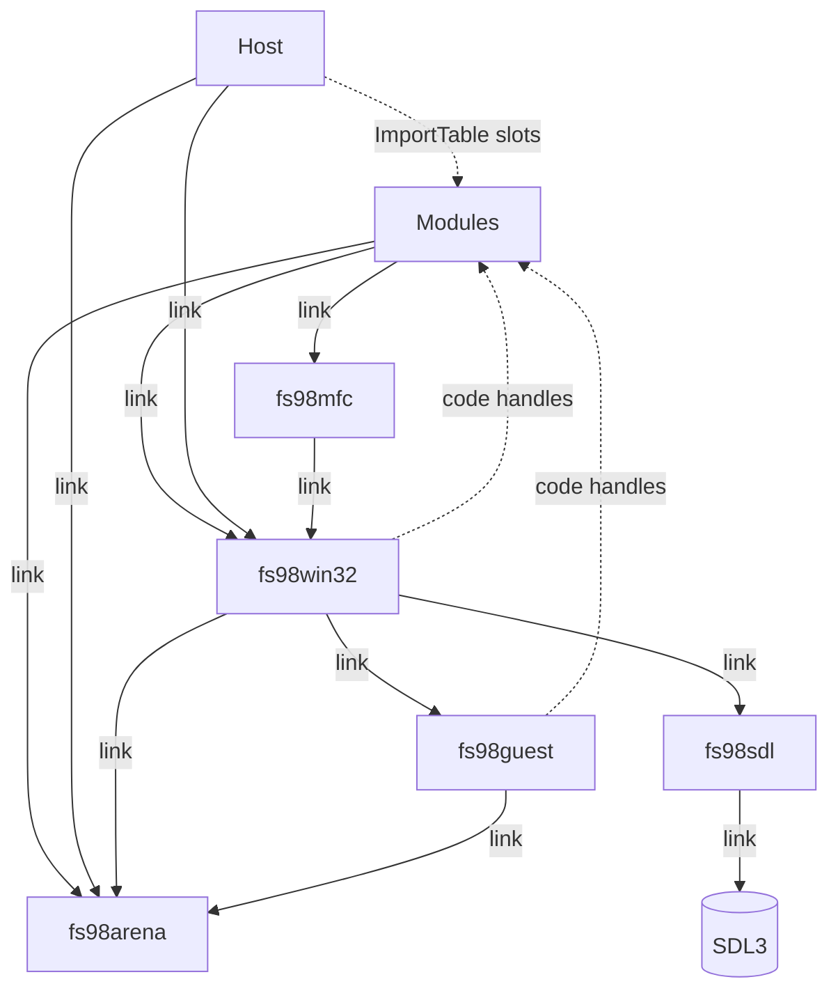
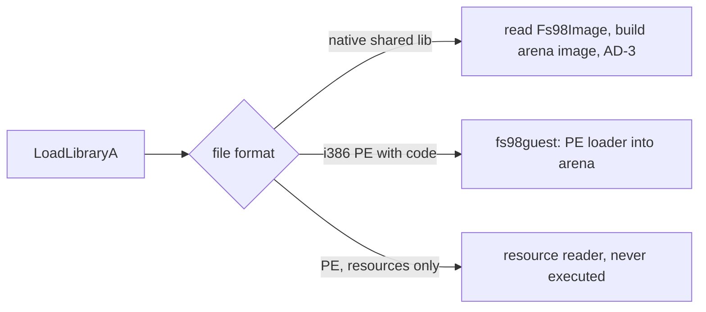
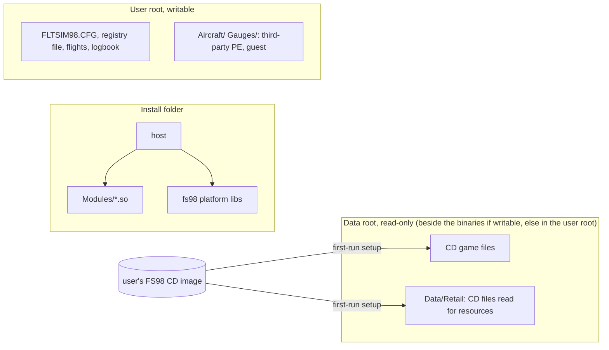

# Architecture Spine — OpenFS98 native port

Built on `../SPEC.md` (updated 2026-11-15 to this spine's memory model, tier list and setup capability). Its capabilities and constraints bind here.

## Design Paradigm

**Microkernel.** The host is retail's module host, which links numbered modules through `Linkage`/`ImportTable`; every module, ours or an add-on, is a plug-in. Below it is a **layered platform**.
- Link-time dependencies point only downward.
- Calls upward (`fs98win32` into a module's `WNDPROC`, the guest into PANELS) go only through code handles the upper layer registered (AD-17).
- `fs98arena` holds the code-handle registry and the log sink, so every layer can reach them.
- Modules call each other only through `ImportTable` slots.

| Layer | Lives in | Holds |
| --- | --- | --- |
| Modules | `src/<module>/` | decompiled FS98 modules, native add-ons |
| Host | `src/host/` | module scan and linking, main loop |
| Win32 personality | `src/platform/win32/`, `src/platform/mfc/` | `fs98win32` (Win32, DirectX and MSVCRT surfaces, FRAMELOCK), `fs98mfc` (decompiled MFC42) |
| Guest | `src/platform/guest/` | `fs98guest`: x86-32 interpreter, PE loader, thunks |
| Machine | `src/platform/sdl/`, `src/platform/arena/` | `fs98sdl` (SDL3), `fs98arena` (arena, allocator, code handles, arena stack, log sink) |



## Invariants & Rules

### AD-1 — One 32-bit arena per process [ADOPTED]

- **Binds:** all modules, host, guest, SDK; CAP-2…CAP-8
- **Prevents:** mixed pointer models, layouts drifting from retail, a guest that can't see what retail gauges saw
- **Rule:** All FS98 memory lives in one arena:
  - module images, and GLOBAL (retail's 4,776 bytes, `0x12a8`);
  - the FS98 heap and every guest image;
  - every object FS98 or guest code can hold an address of, at retail layout: MFC objects, COM interfaces, DIB sections, `LockResource` data.

  An address is a `uint32_t` offset from the arena base, and a vtable is an arena array of code handles. On 64-bit targets the arena is a reserved 4 GB plus 64 KB region. On i386 it is the process address space with base 0, and `fs98arena` allocates only from a reserved sub-range. Native add-on authors use typed structs (AD-14); address-valued fields go through `fs98_ptr(handle)` and `fs98_handle(ptr)`. The guest shares the arena, so PANELS `+0x98` gives a gauge a pointer straight into GLOBAL, as retail does. Arena pages are ordinary cached memory.

### AD-2 — Every module is a shared library in `Modules/` [ADOPTED]

- **Binds:** our modules, add-ons, host; CAP-8, CAP-9
- **Prevents:** a second loading path that only add-ons exercise
- **Rule:** Ours and add-ons alike build as native shared libraries (`.so`, `.dylib`, `.dll`), each exporting one `Fs98Image` descriptor (AD-3). The host lists `Modules/` (the install's, then `<user root>/Modules/`) in ASCII-uppercase-sorted filename order on every platform and loads each one through `LoadLibraryA` (AD-7). Module id 19 (GAUGES) stays a null slot natively.

### AD-3 — `LoadLibraryA` is the only owner of module images

- **Binds:** host scan, PANELS, MAIN/ACONTAIN (MDLs, `SIM1.sim`), every native module
- **Prevents:** two live copies of a module's state; images built without relocation; stale statics after reload
- **Rule:** Each native module exports exactly one data symbol, a const `Fs98Image` descriptor. It gives:
  - image size and the offsets of `Linkage` and `ImportTable`;
  - the initial bytes: always our own, compiled from the module's decompiled `.data`/`.rdata` initialisers (AD-12); no retail file is read for an image;
  - the relocation list (data→data, and data→code as function ids);
  - the function table and `DllMain` as a function id.

  On every load, reloads included:
  1. Allocate a fresh arena image.
  2. Copy the initial bytes.
  3. Apply the relocations: data targets become arena offsets, code targets become code handles.
  4. Set the module's `D`/`RDATA`.
  5. Call `DllMain` through its handle on the sim thread.

  `GetProcAddress` on a native module answers from the descriptor, never `dlsym`. Native modules have no ELF or Mach-O constructors and no mutable state outside their arena image.

### AD-4 — Calling convention between modules

- **Binds:** every service and caller, guest thunks; CAP-1…CAP-4
- **Prevents:** register contracts that exist only on i386
- **Rule:**
  - On every native target, `linux-i386` included, a service is a plain C function in the platform's default convention. Any value retail carries in a register across a call (the `keep.h` entries, callers reading `ecx`/`edi`, and the 7 the CD's `memmove` leaves in `ecx` for ANALYSIS) is an explicit parameter or result.
  - Register-keeping `FS98_ENTRY` wrappers and the `.S` entry stubs build only under `FS98_RETAIL_ABI` (the `win32-retail` target). `FS98_STDCALL` is defined once, in `include/fs98/abi.h`.
  - Guest↔native thunks follow each code handle's registered signature (AD-17) and preserve `ebx`, `esi`, `edi` and `ebp`.

### AD-5 — Our Win32 personality on every platform [ADOPTED]

- **Binds:** all UI and windowing code, `fs98mfc`; CAP-5, CAP-6, CAP-10
- **Prevents:** per-platform dialog behaviour; converting between arena and real Win32 structs
- **Rule:** USER32/GDI32 behaviour comes from `fs98win32` drawn through SDL3, with the decompiled MFC42 above it, on Linux, macOS **and Windows**. No unit calls the real Win32 UI APIs.

### AD-6 — `fs98win32` is a platform library, not a module [ADOPTED]

- **Binds:** all modules, guest import resolution
- **Prevents:** two Win32 surfaces that drift apart; collisions with libc and real system DLLs
- **Rule:** Modules link `fs98win32` like libc and include only `include/fs98/win32/windows.h`, never a system or mingw `windows.h`. That header uses arena types and retail layouts (AD-14) and maps each Win32 name onto an `fs98_`-prefixed export. Guest imports bind to the same prefixed functions. `fs98win32` has no FS98 module id. `HWND`, GDI and kernel handle values are never reused within a session.

### AD-7 — One loader, chosen by file format [ADOPTED]

- **Binds:** host scan, PANELS gauge loads, MDL loads, resource-DLL loads; CAP-7, CAP-8
- **Prevents:** per-caller loaders that disagree on third-party binaries
- **Rule:** `LoadLibraryA` dispatches:



  - **Handles:** `GetProcAddress` returns a code handle, or an arena address for exported data; `FreeLibrary` dispatches the same way. An `HMODULE` is the arena address of the image base. Already-loaded modules match by module name as on Win98, documented in `docs/` with a test.
  - **Guest calls:** guest-to-native calls always go through a thunk, and no native code runs on the guest stack. The PE loader resolves imports between guest images and their resources.
  - **Missing imports:** an import the shim lacks binds to a handle that logs `dll!name` and raises an access violation when called; the load succeeds.
  - **Retail modules:** a PE with code in `Modules/` loads in the guest under AD-13.

### AD-8 — Retail comparison without wine [ADOPTED]

- **Binds:** `fs98win32`, host, test tooling; CAP-1…CAP-4
- **Prevents:** a build that can't be compared, or one compared against a moving baseline
- **Rule:**
  - **References:** retail is recorded once under wine (the 74 flights plus scripted flights) into reference logs kept **outside git** (`bin/`). The manifest is committed: flight, commit, CD pressing, config and checksums.
  - **Where FRAMELOCK lives:** its clock, timers, script and blit logging live in `fs98win32`, which owns time and blits. The host marks a pass by calling `fs98_framelock_pass()` where retail's main loop reads the clock (`0x402177`). Lines go to the `fs98arena` log sink, and FRAMELOCK's own paths are host-native.
  - **Log rules:** the log grammar is frozen in `docs/tools.md`. Comparison is per window, on the last presented frame each pass. Modal loops advance the clock and run script lines at each idle wait. Dumps mask relocated dwords to null or non-null and log no handle values.
  - **What compares against what:** CAP-1 against the retail references, and CAP-2 against an i386 run of the same commit. When i386 is removed, references are recorded once from the bug-fixed i386 build in the same way, and Windows x64 compares against those. Tier-2 targets compare within their documented tolerances.
  - **Wine difftests** stay the tool for decompiling (MFC42), not for checking the port.

### AD-9 — One thread and one clock for FS98 code [ADOPTED]

- **Binds:** host, all modules, guest, `fs98win32`, `fs98sdl`, MULTIP; CAP-10, CAP-11
- **Prevents:** races on the arena; time sources that disagree; callbacks arriving in nondeterministic order
- **Rule:**
  - **The sim thread:** the main loop, window procedures and every callback run on the sim thread, which is the process's main thread on every platform.
  - **Module threads:** `CreateThread` from module or guest code (MULTIP's send and receive workers, BOOSTER, UTIL's trace) makes a real OS thread with its own arena stack region and its own TIB and SEH list (AD-16, AD-19). The allocator, the handle tables and `fs98win32` are thread-safe.
  - **Time:** every Win32 time call and `MSG.time` derives from one `fs98win32` clock, which FRAMELOCK can make virtual. Multimedia timers and every Win32 callback run on the sim thread, at the main loop's clock read, in due order.
  - **Sound:** DirectSound buffers are mixed into a ring buffer on the sim thread once per pass, and the SDL audio callback reads only that ring.
  - **Platform threads:** `fs98win32`'s own threads (the DPLAY transport, audio) never run module code. They reach FS98 threads only through queues, drained at the start of a pass or at the receiving thread's next wait.

### AD-10 — Retail code sees only DOS paths [ADOPTED]

- **Binds:** all modules, guest, setup, `fs98win32`
- **Prevents:** case, separator and buffer-size bugs; nowhere to save flights
- **Rule:** All file access goes through `fs98win32`; no module calls POSIX or native file APIs.
  - **Paths:** the install appears as `C:\FLTSIM98\`, and every returned path fits retail's buffers. That root is layered: a read-only data root under a writable per-user root (`SDL_GetPrefPath`), and writes go to the user root. The data root defaults to beside the binaries when that folder is writable, else it lives in the user root; setup shows the path and lets the user change it. Saves, config, the registry file and third-party `Aircraft/`/`Gauges/` always live in the user root.
  - **Where the data root is:** a key in the user root's registry file, written only by setup. If it is missing or invalid, setup runs again with the last path filled in.
  - **Overlay:** lookup tries the user root, then the data root. Listings merge, deduplicated, with the user root winning. The first write to a data-root file copies it up; deleting one leaves a whiteout in the user root. The data root is only ever opened read-only.
  - **Lookup and listing:** lookup ignores case. When several entries match, the first in ASCII-uppercase order wins and the event is logged. A new file keeps the caller's case. `FindFirstFileA` lists in ASCII-uppercase order. Names are CP1252, mapped to UTF-8.
  - **Registry:** calls go to a REGEDIT4-text file in the user root, which `fs98win32` owns.

### AD-11 — CMake, one flag set [ADOPTED]

- **Binds:** all build rules, add-on builds; CAP-1…CAP-4, CAP-9
- **Prevents:** per-platform build forks; UB-sensitive code behaving differently per unit
- **Rule:**
  - **Targets:** CMake builds every target from its own toolchain file:
    - `win32-retail`: mingw i686, for difftests, retail-ABI add-on builds and reference recording;
    - `linux-i386` (GCC `-m32`) and `linux-x86_64`;
    - `windows-x64` (mingw-w64);
    - `macos-x86_64` and `macos-arm64` (Apple Clang).
  - **Flags:** one flag set for every unit, published as the `OpenFS98::module` interface target that add-ons link: `-fwrapv -fno-strict-aliasing -fno-delete-null-pointer-checks` plus AD-20's floating-point flags. Any per-module override is listed in the toolchain file with its reason.
  - **Dependencies:** SDL3 and libcdio build from checksum-pinned source tarballs, never system packages.
  - **Makefile:** retired once CMake reaches parity.

### AD-12 — Distribution and first-run setup [ADOPTED]

- **Binds:** packaging, setup; CAP-6
- **Prevents:** shipping Microsoft bytes; an installer that looks unlike FS98
- **Rule:** Neither releases nor the git repo contain **bytes copied or generated from a Microsoft file**: no raw `.data`/`.rdata` dumps and no retail resources. A module's initial data is decompiled, like its code: C initialisers (tables, constants, strings) verified by the difftests. Releases are per-platform tarballs or zips.
  - On first launch a setup dialog in retail MFC style (built on `fs98mfc`) asks for the user's FS98 CD: an ISO 9660 or BIN/CUE image read with libcdio, a mounted folder, or a drive.
  - It installs the game files, and copies the CD files our units read resources from (`FLTSIM98.EXE`, `Modules/*.DLL`, the language DLLs) into `Data/Retail/`. Those files are never executed.
  - It strips `;1` and writes names in the case AD-10 chooses, so every source installs the same tree.
  - **Pressings:** setup accepts a pressing when its game files and the resources our units read match the catalogue in `docs/building.md`, file by file. Rebuilt programs, like the November 1997 pressing's, are fine, since no image is read from them. An uncatalogued pressing is refused with a message naming it.

### AD-13 — Module ids decided before any code runs

- **Binds:** host, setup, add-ons
- **Prevents:** a retail module running beside ours under one id; two add-ons claiming one id
- **Rule:**
  - **Setup:** it never installs CD code we replace into `Modules/`, `Gauges/` or `Aircraft/`; `Data/Retail/` copies aren't modules.
  - **Reading ids:** the host reads each candidate's id before any of its code runs, from the PE's on-disk `Linkage` or from the native `Fs98Image`.
  - **Clashes:** a native module beats a PE; between two natives, the first in sorted order wins. The loser is skipped with a log line.
  - **Id ranges:** ids 1–39 are retail's. Ids 40–63 are reserved for OpenFS98 and listed in `include/fs98/linkage.h`, id 12 included (FRAMELOCK's under wine).

### AD-14 — The module ABI is 32-bit on every build

- **Binds:** `include/fs98/`, every shared struct, `fs98win32` signatures; CAP-8, CAP-9
- **Prevents:** add-ons whose tables and structs shift on LP64 or LLP64; per-compiler layouts
- **Rule:** Every type that describes FS98 memory or a service signature uses `fs98_addr` (a `uint32_t` arena offset) for data and `fs98_code` (a `uint32_t` code handle) for code. It never uses a C pointer, `long`, `size_t`, `wchar_t`, a bitfield or `long double`.
  - 80-bit fields are `uint8_t[10]`.
  - `WCHAR` is `uint16_t`, and wide literals use `FS98_W`.
  - Structs carry explicit padding, `#pragma pack(push, 4)` where retail is 4-packed, and `_Static_assert` size and offset checks that compile on every AD-11 target.
  - `win32-retail` maps the same types to real 32-bit values, so a CAP-9 add-on uses one header for both builds.

### AD-15 — One definition of the address macros

- **Binds:** every module, `fs98mfc`, `fs98win32`
- **Prevents:** private macro copies that only work where the base happens to be 0
- **Rule:**
  - **Definitions:** `M8`…`MD`, `R8`…`RDB`, `DA`, `D`, `RDATA`, `fs98_ptr`, `fs98_handle` and `fs98_call` are defined once, in `include/fs98/arena.h`, base-relative. `D` and `RDATA` are `uint32_t` offsets. Private copies are deleted as each module is ported.
  - **The lint check:** a CMake check fails on any `(uint32_t)(uintptr_t)` cast, or any `#define` of those names, outside `src/platform/arena/`. `fs98_handle` asserts its pointer is inside the arena.
  - **Test builds:** 64-bit test builds map the arena at a nonzero base, randomised per run. Base 0 is a release-only optimisation inside `arena.h`.

### AD-16 — Arena stack and pointer parameters

- **Binds:** every native caller of a service or `fs98win32` export
- **Prevents:** each module inventing scratch buffers, which then break on reentrancy
- **Rule:**
  - **Pointer parameters:** every pointer parameter or result of an export, and every pointer field of a retail struct, is an `fs98_addr`.
  - **The arena stack:** `fs98arena` owns one LIFO arena stack on the sim thread, the same region the guest uses as `esp`. Native code gets temporary arena memory (out-structs, string buffers) only through `FS98_FRAME_BEGIN`, `fs98_frame_alloc(n, align)` and `FS98_FRAME_END`, allocated below the guest's current `esp`.
  - **Constants:** constant strings and tables that cross a boundary live in the module's `RDATA` image or come from `fs98_str(literal)`, which stores the literal in the arena once per process.
  - **Forbidden:** static scratch buffers used as call-out areas.

### AD-17 — Code handles

- **Binds:** `fs98arena`, every slot, every vtable, guest thunks
- **Prevents:** slots read as native pointers; thunks that can't know arity or result kind; stale slots calling the wrong code
- **Rule:**
  - **What a handle is:** the arena address of a 16-byte stub in a reserved, non-readable region. A guest jump there traps into the thunk path.
  - **Signatures:** each handle is registered with a signature: convention (`cdecl`, `stdcall`, `thiscall`), argument dwords, and result (none, `eax`, `edx:eax` or `st0`).
  - **Registration:** registering the same function twice returns the same handle. Handles are never recycled and never equal native addresses, i386 included. Calling a revoked handle raises an access violation at its address.
  - **Calling:** native code calls a handle only through `fs98_call*`. The per-module `CALL()` macros are replaced by it.

### AD-18 — Integer divide never traps

- **Binds:** all modules, guest, host
- **Prevents:** divides that differ per CPU; four implementations of one repair
- **Rule:** Every retail division that can fault calls a helper from `include/fs98/divide.h`: `fs98_div32`, `fs98_idiv32`, `fs98_div16`, `fs98_idiv16`, `fs98_div8` or `fs98_idiv8`. They return what retail's host filter `0x4119a0` writes: division by zero and overflow both saturate.
  - Module-private copies and inline `div`/`idiv` asm are removed.
  - `fs98guest` applies the same helpers to a faulting guest divide.
  - The native host traps divide faults only to log the site and abort, so a missed site fails CAP-1 loudly. `host_rt_divide.c` exists only in `win32-retail`.

### AD-19 — One exception chain

- **Binds:** the modules with private `*_unwind.h` (ALERTS, SIM, WORLD, OPTIONS, HELP, FLIGHTS, MPDIALOG), `fs98mfc`, the guest
- **Prevents:** writes to `%fs:0` corrupting glibc's TLS; throws that can't unwind each other's frames
- **Rule:**
  - **The chain:** the sim thread has one SEH list, the `ExceptionList` of an arena-resident TIB owned by `fs98win32`. It is also the guest's `fs:0`.
  - **Records:** native code pushes and pops records only through `fs98_seh_enter` and `fs98_seh_leave`. Records live in the arena, and their handlers are code handles.
  - **Dispatch:** `RaiseException`, MFC throws and guest faults all dispatch through that list with Win32 two-phase semantics.
  - **Forbidden:** no unit touches `%fs`, `%gs` or the TEB directly.

### AD-20 — Floating point

- **Binds:** toolchain files, host, guest, `fs98win32`, `fs98sdl`; CAP-2…CAP-4
- **Prevents:** SSE math ignoring the game's x87 precision; FMA contraction; units disagreeing on the control word
- **Rule:**
  - **Compiler flags:** the tier-1 toolchains (GCC on `linux-i386` and `linux-x86_64`, mingw-w64 on `windows-x64`) compile every unit with `-mfpmath=387 -ffp-contract=off -fexcess-precision=standard`. Tier-2 toolchains (`macos-x86_64`, `macos-arm64`) use `-ffp-contract=off`. No unit overrides them.
  - **One control word:** on x86 it is the real x87 control word; elsewhere it is `fs98_fpu_cw` in `fs98arena`. The host sets it to retail's measured main-loop value when the sim thread starts.
  - **The guest:** `fs98guest` copies the guest's control word in at every guest→native transition and back out at native→guest.
  - **System calls:** every call from `fs98win32` or `fs98sdl` into SDL or system code saves and restores the x87 control word and MXCSR.
  - **Precision:** 24-bit mesh precision as SPEC states.
  - **The guest off x86:** `fs98guest` may use soft 80-bit x87 on non-x86 hosts; native code may not.

### AD-21 — One SDL window per top-level window [ADOPTED]

- **Binds:** `fs98win32`, `fs98sdl`, WINDOW, MAIN, every dialog; CAP-5, CAP-10
- **Prevents:** screen metrics and window placement that change with the user's monitor and break comparison; units stealing events
- **Rule:**
  - **Windows:** each top-level `HWND` (the main window, undocked views, dialogs) is its own borderless SDL window. `fs98win32` draws the Win98 title bars and borders.
  - **Coordinates:** Win32 coordinates and `GetSystemMetrics` refer to a virtual screen, a fixed 640×480 under FRAMELOCK and taken from the display otherwise, mapped onto real positions where the platform allows (positions are hints on Wayland).
  - **Events:** SDL events are consumed only inside `fs98win32`'s message retrieval (`GetMessage`, `PeekMessage`, `WaitMessage`, `MsgWaitForMultipleObjects`).

### AD-22 — Arena region map and one allocator

- **Binds:** `fs98arena`, host `+0x20c`, CRT, `fs98win32`, guest loader
- **Prevents:** load-history-dependent placement; per-target heap layouts that change what kept retail bugs read
- **Rule:**
  - **Fixed regions:** `0x0`–`0xFFFF` is never mapped; the code-handle region is fixed; guest preferred bases come from their own range, placed deterministically.
  - **The heap:** one deterministic algorithm, identical on every target, 8-byte aligned, with no guard bytes in release builds.
  - **One allocator:** host `+0x20c`, CRT `malloc`/`new`, `HeapAlloc`, `GlobalAlloc`, `LocalAlloc` and the guest CRT all allocate from it.

### AD-23 — Modules use only the MSVCRT-behaviour CRT

- **Binds:** all modules, `fs98mfc`, guest CRT imports; CAP-1, CAP-2
- **Prevents:** libc's `sprintf`, `rand`, `qsort` or `strtod` silently changing what the sim computes
- **Rule:** Modules, `fs98mfc` and the guest use only `fs98win32`'s CRT, which behaves like the CD's `MSVCRT.DLL`: formatting, `rand`, `qsort` order, string-to-number conversion, `_ftol`, and `memmove` leaving 7 in `ecx` on `win32-retail`. Platform libc is allowed only inside `src/platform/`. A link-time check fails a module that imports a libc symbol outside an allowlist (`memcpy`, `memset`).

### AD-24 — Every system DLL is served by `fs98win32`

- **Binds:** HG2D, SOUND, CONTROLS, MULTIP, host, guest; CAP-10, CAP-11
- **Prevents:** each module porting its DirectX or WINMM use differently
- **Rule:** `fs98win32` serves every system DLL a module or the guest imports, with retail-shaped interfaces in the arena: DDRAW, DSOUND, DPLAY, WINMM (`joy*`, `mmio`, timers, wave), MSACM32, ADVAPI32 (registry, AD-10), SHELL32, COMCTL32, IMM32 and sockets. COM objects use vtables of code handles.
  - **Sockets:** `include/fs98/win32/winsock2.h` lists the subset, served as both `WS2_32` and `WSOCK32`. `SOCKET` is a 32-bit handle, never reused (AD-6, AD-14). A blocking call blocks only its own thread.
  - **DPLAY:** it speaks the DirectPlay wire protocol of [MC-DPL4CS], advertising DX9VERSION (14), through the TCP/IP service provider only: port 47624 (UDP broadcast, and TCP to a named host), sessions on TCP and UDP 2300–2400. Peers on DirectX 6 or later runtimes, retail FS98 included, share LAN sessions. DirectX 5-only peers and [MC-DPL4R] are out of scope. Its timers run on real monotonic time in its own worker, never on FRAMELOCK's clock. A module's bind to DPLAY's ports fails. Player and session names are CP1252 on the wire, and MULTIP's message formats stay retail's. Until a GPU renderer exists, `Direct3D*` creation fails, so HG2D takes its software path and the mesh compiler isn't reached.

### AD-25 — `fs98mfc` and the add-on dialog API

- **Binds:** `fs98mfc`, SIMSUI, World, Options, add-ons, setup; CAP-5, CAP-6, CAP-9
- **Prevents:** builders disagreeing on MFC object placement, `this` passing and vtables; add-ons needing two dialog sources
- **Rule:**
  - **The library:** `fs98mfc` is written in C. Its objects live in the arena at retail layouts, `this` is an explicit first `fs98_addr`, and vtables are arena arrays of code handles. Entries are named by ordinal (`fs98mfc_<ordinal>_<name>`).
  - **The add-on API:** `include/fs98/dialog.h` gives add-ons one dialog API. It maps onto retail MFC42 ordinals in the `win32-retail` build and onto `fs98mfc` natively.

### AD-26 — Resources

- **Binds:** host, English modules, our own dialogs, guest PEs
- **Prevents:** each module storing resources its own way; Microsoft resources inside our binaries
- **Rule:**
  - **Retail resources:** a native module reads its retail resources from the retail file its `Fs98Image` names in `Data/Retail/`.
  - **Our resources:** resources OpenFS98 authors (the setup dialog, new options) ship as a compiled `.res` blob in the module's exported `fs98_resources`.
  - **One parser:** `fs98win32`'s resource reader serves `FindResourceA`, `LoadStringA` and `DialogBoxParamA` from both, and from `.rsrc` for PEs.

### AD-27 — Testing the port

- **Binds:** test tooling, every target; CAP-1…CAP-7
- **Prevents:** a port verified only by whole flights; dialog drivers that need wine
- **Rule:**
  - **Driving dialogs:** `main-dialogs` and `flights-play` drive dialogs through FRAMELOCK scripts inside `fs98win32`, not by posting messages from outside the process.
  - **Gauges:** CAP-7's guest-versus-native check runs a retail gauge binary in `fs98guest` and its decompiled native beside it on the same element inputs, comparing outputs.
  - **The flight check:** one scripted `tools/` target runs the 74-flight check for a given target and writes a report that compares across targets.
  - **Multiplayer:** an interop test hosts and joins against retail FS98 on Windows DirectPlay, in both directions, on two machines.

## Consistency Conventions

| Concern | Convention |
| --- | --- |
| Platform libraries | `fs98<part>`: `fs98arena`, `fs98win32`, `fs98mfc`, `fs98guest`, `fs98sdl` |
| Module files | retail name with the platform suffix (`PANELS.so`, `PANELS.dylib`, `PANELS.dll`) |
| Addresses in C | `uint32_t` arena offsets through `include/fs98/arena.h` only (AD-15); never a C pointer in FS98 memory |
| Retail references | comments cite retail VAs and service offsets (`0x206e35b0`, `+0x98`), as now |
| Kept retail bugs | `RETAIL BUG (kept): <id>` plus `docs/retail-bugs.md` until CAP-1 passes, then every one is fixed and no marker remains; a bug that reads uninitialised stack or heap takes retail's observed value from a documented source (the arena stack's prior contents, or a recorded constant), never native garbage |
| Logging | every layer writes to the `fs98arena` log sink; nothing writes to stdout or stderr; guest `OutputDebugStringA` goes there too |
| Config | `FLTSIM98.CFG` as retail, in the user root (AD-10) |
| Floating point | AD-20; 24-bit mesh precision (SPEC) |

## Stack

| Name | Version |
| --- | --- |
| C | C99 (as now) |
| CMake | 4.4.x |
| SDL3 | 3.4.x |
| libcdio | 2.3.0 upstream tarball, checksum-pinned (libiso9660 + BIN/CUE) |
| GCC | system GCC with i386 multilib (`linux-i386`, `linux-x86_64`) |
| mingw-w64 | i686 (`win32-retail`), x86_64 (`windows-x64`) |
| Apple Clang | Xcode toolchain (tier 2) |
| CI | GitHub Actions; Mac targets build and run CD-free tests only (`macos-15-intel` or `macos-26-intel`, `macos-26`) |

## Structural Seed

```text
OpenFS98/
  CMakeLists.txt
  cmake/toolchains/      # one toolchain file per AD-11 target
  include/fs98/          # abi.h, arena.h, divide.h, dialog.h, linkage.h, host.h (AD-14), win32/windows.h
  src/<module>/          # the 27 modules
  src/host/              # retail-ABI host (existing) and the native host
  src/platform/
    arena/  win32/  mfc/  guest/  sdl/
  tools/                 # difftests, FRAMELOCK scripts, reference recording, 74-flight report
  docs/native-port/      # SPEC.md, decisions.md, this spine
```



## Capability → Architecture Map

| Capability | Lives in | Governed by |
| --- | --- | --- |
| CAP-1 i386 | host, modules, platform | AD-3, AD-4, AD-8, AD-11, AD-15, AD-18, AD-20, AD-27 |
| CAP-2/3 x86-64, Windows x64 | same | AD-1, AD-14, AD-15, AD-16, AD-17, AD-20, AD-23 |
| CAP-3 Intel Mac, CAP-4 Apple Silicon (tier 2) | same | AD-1, AD-8, AD-20; SPEC tolerances |
| CAP-5 retail dialogs | `fs98win32`, `fs98mfc` | AD-5, AD-6, AD-21, AD-25, AD-26 |
| CAP-6 new FS98-style dialogs | `fs98mfc` | AD-25, AD-26 |
| CAP-12 first-run setup | setup, `fs98mfc` | AD-10, AD-12, AD-13, AD-26 |
| CAP-7 third-party aircraft and gauges | `fs98guest`, PANELS | AD-1, AD-7, AD-17, AD-19, AD-27 |
| CAP-8 native add-on modules | host, SDK headers | AD-2, AD-3, AD-13, AD-14 |
| CAP-9 dual-built add-ons | add-on repos | AD-11, AD-14, AD-25 |
| CAP-10 input, sound, timing | `fs98win32`, `fs98sdl` | AD-9, AD-21, AD-24 |
| CAP-11 multiplayer | MULTIP, `fs98win32` DPLAY | AD-9, AD-24 |

## Deferred

- **Static linking of our modules:** not needed while AD-2's single path holds; same tables if added.
- **An add-on deliberately replacing one of our modules:** it loses on an id clash (AD-13) until an override mechanism is designed.
- **GPU renderer:** its own later work (SPEC); it enables `Direct3D*` under AD-24.
- **Multiplayer beyond the LAN:** internet play (NAT traversal, lobbies) comes after the LAN DirectPlay sessions of CAP-11.
- **macOS signing and notarisation, packaging beyond zip/tarball:** decided at first release. The per-target report (AD-27) exists before then.
- **The order retail bugs are fixed in:** follows `retail-bugs.md`'s triage after CAP-1.
- **Mac flight checks:** a user-run 74-flight script, added only if Mac users report real issues. Intel macOS runners end with macOS 15's retirement (fall 2027); the Intel target is then built elsewhere or dropped from CI.
- **Android:** a separate project (SPEC).
- **Retail's main-loop x87 control word:** measured before AD-20's host init is coded.
- **Decompiling the 26 committed `*_data.inc` images into C initialisers (AD-12):** a story of its own.

